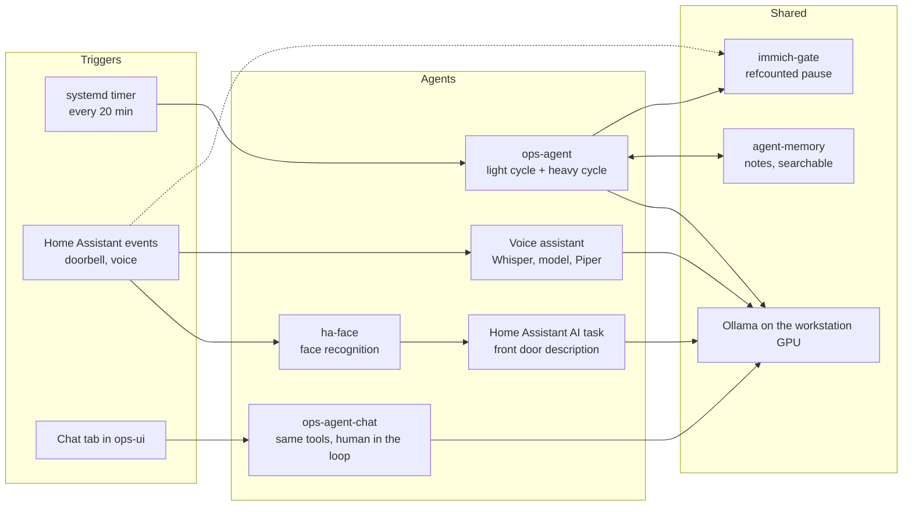
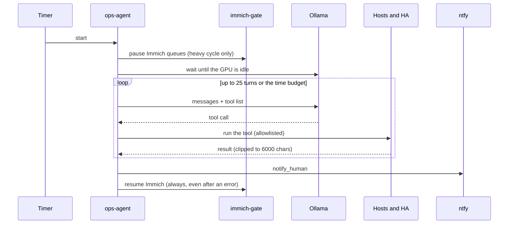

# AI design

How the agents in this lab work, what each one is allowed to do, and what
went wrong along the way. Last updated 2026-10-21.

## The pieces

## ops-agent

A Python script on the Proxmox host, run by a systemd timer every 20 minutes.
A local Ollama model decides what to do and calls tools. It never gets a shell.

**Light cycle** (every tick, no model calls). Plain Python finds crashed
containers and stopped LXCs or VMs and fixes them. Anything that needs
judgment is left for the heavy cycle.

**Heavy cycle** (00:00 to 05:00). The model works through a fixed checklist:

1. Check Proxmox guests, Home Assistant, Home Assistant automations and
   resource trends.
2. Call `scan_container_updates` once. It checks every managed container in
   parallel and returns only the ones with an update.
3. For each hit, read the changelog (`check_changelog`). A breaking change means
   notify and wait. Otherwise apply the update. Every update takes a backup
   first, tags the old image for rollback and rolls back if the health check
   fails.
4. Check and apply Home Assistant core, OS and add-on updates through its API.
5. Patch the OS on the hosts in `os_auto_hosts`.
6. Notify a human about anything that mattered, then save a short note to
   memory.

### Tools

The model can call only these, grouped by what they do:

- **Look**: `list_containers`, `get_logs`, `check_proxmox_infra_status`,
  `check_ha_health`, `check_ha_updates`, `check_automation_health`,
  `check_expected_automations_enabled`, `check_sensor_value_stuck`,
  `check_restart_loop`, `check_resource_limits`, `check_host_resource_trend`,
  `check_qnap_app_reachable`, `ha_search_entities`, `ha_get_state`,
  `ha_get_history`, `ha_get_logbook`.
- **Check for updates**: `scan_container_updates`, `check_for_update`,
  `check_upstream_tag_update`, `check_changelog`, `check_upstream_tag_changelog`,
  `check_ha_updates`, `check_os_updates`.
- **Change things**: `restart_container`, `apply_update`,
  `bump_compose_tag_and_apply`, `apply_ha_update`, `apply_os_updates`,
  `docker_cleanup`, `start_proxmox_lxc_or_vm`, `ha_call_service`.
- **Talk and remember**: `notify_human`, `remember_note`, `recall_past`.

ADS-B tools are removed from the list while `adsb_enabled` is false.

### Guard rails

| Guard | What it does |
|---|---|
| No shell | The model can only call the tools above. |
| Hard exclusions | UniFi, QNAP firmware and OS patching of the Proxmox host and the NAS are code rules. The never-patch hosts are filtered out of the config and refused again in `apply_os_updates`. |
| Argument checks | Container names, image references, tags, service names and entity ids from the model must match strict patterns before a tool runs. The QNAP command quotes its URL and body. |
| Home Assistant allowlist | `ha_call_service` is limited to safe domains, one named entity of the same domain, no target keys in the data. No locks, covers or alarm panels. Scripts and scenes only when named in `ha_allowed_entities`, because a script can unlock a door. |
| Chat only automations | Creating or editing automations exists only in the chat sidecar, and only after a human confirms in a later message. |
| Repeat cap | The same tool call with the same arguments is stopped after two tries. |
| Time budget | `cycle_budget_seconds` (2400). A cycle that runs out stops and keeps its results. |
| Turn limit | 25 model turns per cycle. |
| Context limits | Each tool result is clipped to 6000 characters. The oldest tool output is trimmed once the chat passes 60000 characters. |
| Update retries | A heavy cycle that ends early does not count as the daily update check. After 3 failed tries the agent sends one notification and waits 24 hours. |
| Notification dedupe | Notifications with a topic are sent once per cooldown (4 hours). |
| Rollback | Every update tags the previous image first. Non-compose containers are recreated with the old one kept as `<name>.ops-old`, and a parity check compares the two. If the health check fails, the agent restores the preserved container, or re-tags and force-recreates the compose service, or recreates from the saved inspect data. |

### Memory

`remember_note` saves a short note to the agent-memory service (a small API
with search). `recall_past` looks notes up at the start of a cycle, so the
agent does not repeat a fix that already failed.

## Sharing one GPU

The workstation has one GPU. Ollama (ops agent, voice assistant, doorbell
descriptions) and Immich machine learning all use it, and they slow each other
down.

- The ops agent waits until Ollama is idle before each model call.
- Heavy work runs between 00:00 and 05:00 so it does not collide with the day.
- **immich-gate** pauses Immich queues and resumes them, with a reference count
  per owner. A queue that was paused on purpose is never touched. The ops agent
  pauses Immich before its heavy cycle and always resumes in a `finally` block.
- **immich-yield** is a small service that listens to Home Assistant. It pauses
  Immich when the doorbell sees a person or the voice assistant is used, and
  resumes after a quiet period. It is temporary and can be removed once the
  Immich backlog is done.
- Docker CPU limits on the Immich containers keep the machine usable.

## Doorbell recognition

1. The doorbell reports a person. Home Assistant tells `ha-face` to scan.
2. `ha-face` takes several frames, finds faces and matches them against people
   in Immich plus a few extra reference photos from the doorbell camera. It
   posts a state with the names, the number of unknown faces and where each
   person stands. It marks the final result with `final: true`.
3. Home Assistant waits for the final result, then asks a vision model for one
   sentence about the people at the door. The prompt includes the names and
   positions and tells the model to give a name only to the person at that
   position.
4. The notification has a "Teach who this is" button. A reply such as "Sam right" adds that face to the references.

## What went wrong, and the fix

| Problem | Cause | Fix |
|---|---|---|
| Ops agent crashed with HTTP 500 "no user query found" | The prompt was longer than the model context, so Ollama dropped the oldest messages, including the request | Clip tool results, trim old tool output, use a 48K context and probe the GPU with the same context size |
| Agent looped on a device that was down | The restart tool reported success without checking the device | Reachability check, repeat cap and a tool list that hides disabled features |
| Update check marked done after a crash | The done flag was set before the cycle finished | Only set it when the cycle completes, and retry up to 3 times |
| 40 per-container checks used the whole time budget | One container per model turn | `scan_container_updates` does it in plain Python in parallel |
| False "Home Assistant update failed" | A core update drops the API connection while it installs | Treat a dropped connection as expected and check the version afterwards |
| Immich and the agent made the machine unusable | Both used the GPU and CPU at once | The gate, the watcher and CPU limits |
| Doorbell notification named the wrong person | The notification took the first result ("Alex") before the scan ended ("Sam & Alex"), and the prompt asked for one name | Wait for `final`, give the model the positions and describe each person |
