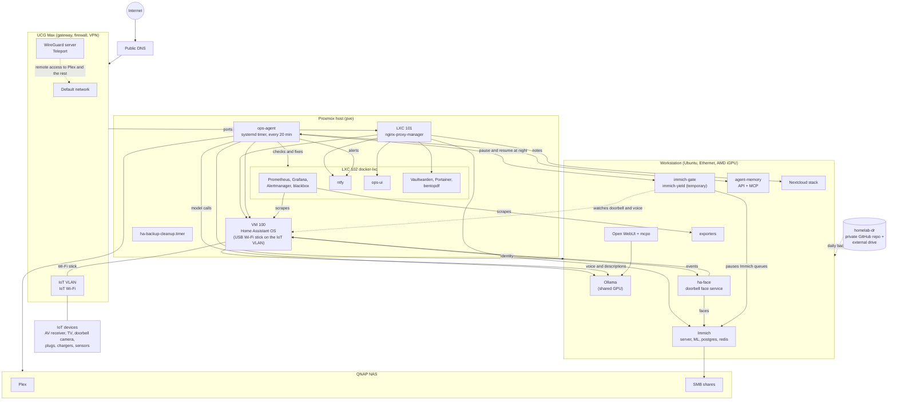

# Home lab architecture

This is the current layout of the home lab that the ops agent looks after.
Last updated 2026-10-21.

## Hosts

- **UCG Max**: gateway, firewall and VPN. It routes four networks: Default,
  IoT, Work and Guest. Public services are published only through
  nginx-proxy-manager. The agent never touches it.
- **Proxmox (pve)**: runs LXC 101 (nginx-proxy-manager),
  LXC 102 (docker-lxc, the monitoring and admin stack), VM 100 (Home Assistant
  OS) and the ops agent itself as a native systemd timer.
- **Home Assistant OS (VM 100)**: the USB Wi-Fi stick is passed
  through to the VM and joins the IoT Wi-Fi, so Home Assistant can talk to
  devices on the IoT network while the admin connection stays on the wired network.
- **Workstation**: Ubuntu on Ethernet with an AMD Strix Halo
  GPU. It runs Ollama, Open WebUI, mcpo, Immich, Nextcloud, the doorbell face
  service, the agent memory service and the metrics exporters.
- **QNAP NAS**: Plex and the SMB shares that Immich mounts.
- **ADS-B Pi**: flight tracking receiver. The agent does not manage it right
  now (adsb_enabled is false).

## Public services

All public names end at nginx-proxy-manager (LXC 101) and are proxied to a
private address. Examples: Home Assistant, the ops UI, ntfy, Vaultwarden,
Immich, Nextcloud, Grafana, Proxmox, Portainer, Open WebUI and a PDF tool.

## Resilience

- **Boot order**: all Proxmox guests start on boot. Immich waits for the NAS
  mount before it starts.
- **Self-healing**: every cycle starts by checking that the LXCs, the VM and
  the NAS apps are up, and starts anything that is down.
- **Backups**: Home Assistant keeps 5 days of backups plus a daily cleanup
  timer and a duplicate check. The `homelab-dr` repo (secrets removed) and an
  external drive (full copy) hold everything needed to rebuild.
- **GPU sharing**: the workstation GPU is shared between the ops agent, the
  voice assistant, the doorbell service and Immich. See ai-design.md.
- **Alerts**: a self-hosted ntfy instance, separate from Home Assistant
  notifications. Only a wake-up ping goes through ntfy.sh for iOS push, never
  the message text.
